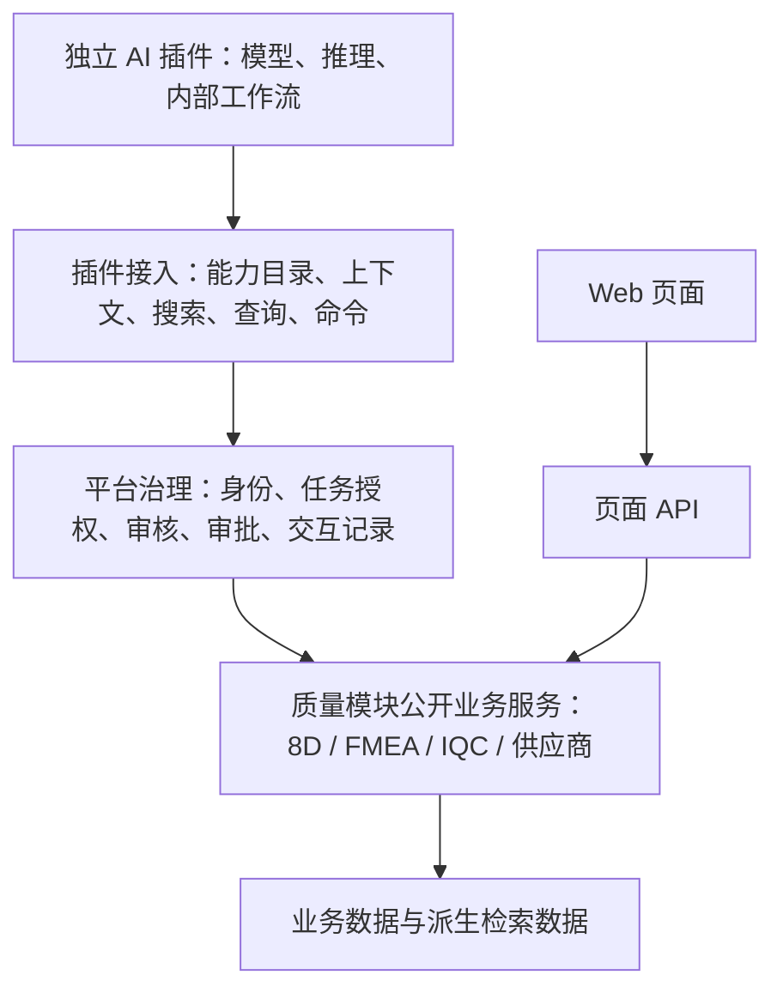

# OpenQMS 模块化业务与 AI 插件架构

日期：2026-09-22  
状态：访谈决策基线；目标设计，尚未整体实现。  
范围：质量业务、AI 插件、上下文与工具契约、权限治理，以及支持持续开发的代码边界。

## 1. 目标与使用方法

质量业务流程相对稳定，AI 如何参与分析和决策仍需不断探索。本架构让质量模块维护业务事实与规则，让独立 AI 插件自由演进模型、推理和工作流，通过明确契约连接两者。

主要验收目标：替换 AI 插件不修改质量规则；新增业务工具不要求所有插件同步升级；人工页面与 AI 使用相同业务能力；已有业务成果可以被其他插件接续；新开发者能定位改动归属和依赖范围。

本文不是当前功能清单。当前实现入口见 [架构概览](../../architecture.md)，维护方式见 [架构与决策维护约定](../../development/architecture-maintenance.md)。本轮只固化文档，不执行代码重构或数据库迁移。

下文“已确认”来自本轮用户选择；“建议”用于把决策落到工程结构；“待定”不得视为实施授权。

## 2. 已确认决策

| 编号 | 决策 | 对实现的约束 |
|---|---|---|
| D01 | AI 插件独立进程或服务运行 | 模型、框架和内部依赖由插件管理；通过标准接口访问 OpenQMS |
| D02 | 基础上下文包＋多轮按需获取 | Agent 决定还缺什么，持续查询；平台不强制固定分析步骤 |
| D03 | 业务查询工具＋统一搜索入口 | 搜索发现对象引用，业务工具读取详情；两者使用相同权限口径 |
| D04 | 模块声明操作边界和最低审批要求 | 管理员可收紧或在允许范围内配置；插件不得绕过业务规则 |
| D05 | 两阶段模型审核支持自动审批 | 快速筛查后按需深入审核；强制人工审批保留 |
| D06 | 长期授权＋本次任务授权 | 工具权限不是对任意任务的通行证 |
| D07 | 读取范围与修改范围分开 | 可以跨对象查证，只能修改任务明确授权的对象 |
| D08 | 默认最新数据＋来源版本＋操作前复核 | 关键依据变化时重新评估，必要时重新审批 |
| D09 | 建议、待验证、已确认、已否定分开 | 保存成功或审批通过不等于业务事实成立 |
| D10 | 插件管理内部工作流 | 平台管理任务、授权、审批与接口交互，不调度插件内部每一步 |
| D11 | 能力目录与兼容性声明 | 必需能力缺失时阻止启动；可选能力可降级 |
| D12 | 页面 API 和工具共用业务服务 | 业务校验、状态流转、读写与业务审计只维护一份 |
| D13 | 8D 根因与措施作为首个样板 | 验证 D4/D5 的上下文、证据、建议和正式操作边界 |
| D14 | 候选根因、措施为结构化对象 | 独立 ID、状态、来源和版本；措施关联根因 |
| D15 | 对已有条目的修改通过修订提交 | 审核采纳后生效；已确认内容变更需判断验证是否失效 |
| D16 | 可提前提出条件性措施 | 正式采纳或执行检查适用条件；根因变化触发措施复核 |
| D17 | 平台保存业务产物及交互记录 | 插件的内部推理、临时笔记、执行状态不要求统一落库 |
| D18 | 接口版本化并提供兼容期 | 强制业务规则和权限更新对所有版本生效 |
| D19 | 保证业务层接续 | 不承诺不同插件恢复相同执行步骤或内部状态 |
| D20 | 用户身份和服务身份并存 | 每次任务固定执行身份；同时记录插件身份，不允许自行切换 |

## 3. 架构与职责



图表示职责路径，不意味着所有读取都必须调用审核模型。所有入口都执行身份、数据范围和业务权限校验；模型审核只用于策略指定的操作。

| 边界 | 拥有的职责 | 不承担的职责 |
|---|---|---|
| 质量模块 | 业务实体、查询语义、命令、状态规则、证据要求、业务审计 | 插件提示词、模型选择、推理步骤 |
| 插件接入 | 能力发现、协议转换、参数与响应契约、上下文入口 | 重新实现质量规则，任意写数据库 |
| 平台治理 | 身份、授权、任务范围、操作审核、审批记录、调用追踪 | 自行确认根因成立，代替业务验证 |
| AI 插件 | 多轮调查、模型调用、推理编排、提出建议和工具请求 | 自授权限，改平台政策，绕过模块接口 |
| Web 前端 | 人工操作、证据呈现、修订对比、审批交互 | 把后端必须执行的规则仅放在按钮显隐中 |

建议：质量系统先按模块化单体组织，AI 插件独立部署；无需把每个质量模块同时拆为微服务。跨模块依赖指向公开接口，通用平台不导入特定插件实现。涉及数据归属的最终决定见第 7 节。

## 4. 接入契约

以下名称是设计示例，具体字段和传输协议由后续接口规格确定，不是现有 API 清单。

### 4.1 插件与能力目录

插件声明标识、版本、所支持的协议版本、必需与可选能力及版本范围、申请的数据和操作范围。管理员登记部署并授予权限；声明本身不构成授权。

能力描述包含稳定标识、业务含义、所属模块、输入输出结构、版本、读取或写入副作用、权限要求、业务前提、最低审批要求和错误语义。目录按当前身份与授权过滤，调用仍须重新校验。暂时不满足业务状态的操作可以标注不可用及原因，不能把“出现在目录”解释成保证执行成功。

接入层将传输协议适配到同一业务接口；HTTP/OpenAPI、MCP 或组合方案尚未选定，不影响核心业务契约。

### 4.2 上下文与多轮查询

基础上下文包含任务目标、当前业务对象及阶段、关键事实、对象引用、可见的关联线索、数据来源和版本。任务授权属于可信控制信息，与业务文本分开传递。

Agent 可反复使用搜索、分页查询和详情读取补充证据。搜索返回有权限访问的摘要及对象引用；详情工具返回规范业务结构。空结果、来源不可用、结果截断、索引滞后应能区分。对无权访问的对象，错误响应不得泄露其存在或属性。

结果携带来源对象、版本或更新时间、业务验证状态。上下文中的附件、历史描述和其他模型产出都是数据，不能改变任务授权。模型自报置信度不代替证据与验证状态。

平台记录返回过的证据引用与版本；插件提交建议或操作时引用相关证据。关键依赖的完整性还需由工具契约规定，不能由插件通过漏报依赖绕过版本检查。

### 4.3 业务命令

命令表达业务意图，例如“保存候选根因”“提交修订”“采纳措施”，不开放任意表字段更新或 SQL 执行。

建议的调用包包含任务 ID、能力及版本、业务对象引用、参数、关键证据引用、预期对象版本和幂等键。身份和租户范围由服务端认证解析，不能信任模型传入的身份字段。

响应区分成功、等待审批、权限不足、业务前提不满足、依据版本冲突和暂时失败，并返回可追踪的调用或审批引用。写入结果包含实际业务版本。审批必须绑定具体操作、参数和关键版本；参数或相关版本改变时，不得复用旧批准。

建议：重复请求按幂等键返回同一操作结果；超时后先查询结果，不能直接重复写入。最终版本检查与写入在事务或等效并发控制中完成，避免“检查通过后数据又改变”。

## 5. 授权与两阶段审核

有效权限由执行身份权限、插件长期授权和任务授权共同限定，模块业务规则始终有效。用户任务代表用户，后台任务代表专用服务身份；每次调用检查当前权限，撤权后不能继续沿用任务创建时的旧授权。

读取与修改使用独立范围。例如可以读取本工厂历史案例，只能为本次任务的 8D 写入建议。统一搜索同样受读取范围约束。

建议的操作路径：

1. 校验身份、插件与任务状态、能力版本、参数、读写范围和业务前提。硬性拒绝不交给模型“翻案”。
2. 根据模块最低要求和管理员策略路由为直接允许、模型审核、人工审批或禁止。
3. 模型审核第一阶段只分类 `needs_review`。被标记或信息不足进入第二阶段；未标记仅在策略允许时放行。
4. 第二阶段结合任务授权、实际参数、可信业务状态、影响范围，返回允许、拒绝或转人工。
5. 执行前复核授权、参数和关键版本，调用业务服务并记录结果。

审核组件由平台管理，与业务插件分离。可信审核上下文由平台组装，插件解释只能作为补充。审核结果不构成新的权限授予，也不证明业务结论正确。

两阶段策略已确认；具体模型、预算和阈值需要评测后确定。不得将“输入上下文 100 token”写成既定限制。建议审核超时、异常或结果无法解析时不执行，返回可处理状态或转人工；记录简明依据、政策与审核器版本，无需保存模型私有思维链。

## 6. 8D D4/D5 样板

### 6.1 业务对象

| 对象 | 目标职责 |
|---|---|
| 候选根因 | 独立 ID、描述、来源、证据引用、版本和业务状态 |
| 措施建议 | 独立 ID、关联根因、适用条件、证据、版本、采纳或待复核状态 |
| 修订提案 | 目标对象与基础版本、拟修改内容、理由、证据和审批结果 |
| 根因验证 | 验证方法、结果、证据、结论及其对应的根因版本 |

建议状态、修订审批状态、业务验证状态分别建模。对已确认事实的实质修改可能使验证失效；对文字修正是否需要重验，由后续业务规格定义。一个措施关联一个还是多个根因、状态枚举及转移矩阵也需单独设计。

已采纳措施关联的根因被否定或改变时，标记待复核并通知责任人；不默认撤销已经发生的现实操作。报告正文作为业务呈现，结构化条目承担身份和关联语义，最终汇总与人工编辑规则由迁移规格确定。

### 6.2 拟议能力

| 类别 | 样板能力 | 约束 |
|---|---|---|
| 初始上下文 | 当前 8D 问题、D3 临时措施、阶段、根因、措施、关联对象 | 附来源、版本与验证状态 |
| 搜索 | 类似 CAPA、相关 FMEA、知识与历史案例 | 权限过滤；结果引用可回查 |
| 详情 | 检验记录、供应商历史、FMEA 节点、验证结果 | 通过所属业务接口取数 |
| 建议写入 | 保存候选根因、保存条件性措施、提出验证方案 | 不等于确认事实或推进阶段 |
| 修订 | 为候选根因和措施提交变更 | 绑定基础版本，审核后生效 |
| 正式命令 | 采纳建议、提交验证结论、申请阶段推进 | 每项分别授权；不能绕过验证和审批 |

示例：Agent 获取 8D 上下文，搜索相似案例，读取 FMEA 和检验详情，发现证据不足后继续查询；保存两个候选根因及各自证据，再提出条件性措施。后续人工或另一插件补充验证结果。正式采纳前，平台检查授权、审核要求和依据版本，由 8D 服务完成业务变更。

第一版只保证业务层接续：插件 B 可读取插件 A 保存的产物和未决事项，重新计划；不要求恢复 A 的内部执行位置。

## 7. 统一数据源：目标与待定归属

已确认目标：插件共享相同的业务含义、对象标识、来源追溯、验证状态及权限口径；不各自维护第二套正式质量事实。插件内部工作状态不属于统一业务数据源。

**尚未确认**：各模块拥有业务数据、平台统一访问，还是建设独立中央数据中心。本轮停止访谈时尚未做出选择。

建议采用模块拥有数据、统一访问契约；搜索索引、向量库与图谱作为可重建派生数据。派生结果带源引用与版本，正式操作回查业务权威记录，处理同步滞后与删除传播。该建议不授权建立新的中央数据模型或执行存储迁移。

即便采用同一个 PostgreSQL 实例，也应明确每个实体的业务责任方。统一来源不要求所有数据存成一张表或所有模块共用同一个通用 CRUD 服务。

## 8. 当前实现锚点与差距

以下为本轮定向阅读结果，不代表全仓依赖审计。

| 现有锚点 | 已观察到的基础 | 目标差距 |
|---|---|---|
| [Agent registry](../../../backend/app/services/agent/registry.py) | 工具描述、readonly/draft/commit、服务端作用域上下文 | 外部插件契约、版本协商、任务级细粒度授权需进一步设计 |
| [Agent gateway](../../../backend/app/services/agent/gateway.py) | 工具权限和 commit 白名单判断 | 两阶段审核、统一独立插件执行身份需对照实现逐项验证 |
| [推荐编排](../../../backend/app/services/recommendation_orchestrator.py) | 固定阶段、多类数据来源和融合流程 | 将可复用检索能力与具体 AI 编排分离，适配多轮插件调用 |
| [根因验证与采纳](../../../backend/app/services/capa_verification_service.py) | 根因验证、证据、采纳记录；采纳追加 D4/D5 文本 | 独立候选、措施、修订及版本绑定 |
| [8D schema](../../../backend/app/schemas/capa.py) | D4/D5 正文字段与关联信息 | 结构化产物及报告呈现间的迁移策略 |
| [图查询接口](../../../backend/app/graph/README.md) | PostgreSQL JSONB 与 Neo4j 投影的读取抽象 | 跨来源一致的版本和证据引用契约 |

2026-06-29 的 [AI 驱动 QMS 总览](2026-06-29-ai-driven-qms-overview-design.md) 将推理循环放在后端 Agent 基座内。本设计对新插件采用独立运行、插件自管工作流的方向。既有内置 AI 功能不会因文档更新自动迁移；后续按功能选择适配、提取或保留，不能立即删除旧实现。

## 9. 代码组织建议

先建立逻辑边界，再按改动逐步整理物理目录。以下是目标示意，不要求一次性移动现有文件。

```text
backend/app/
  modules/capa/           # 业务应用服务、领域规则、存储与公开接口
  modules/fmea/           # 其他业务模块同理
  platform/agent_access/  # 插件目录、任务授权、协议适配
  platform/action_review/# 策略、分类器适配、审批生命周期
  platform/context/      # 统一上下文契约、模块提供者与搜索协调
  api/                   # 人工页面和外部接入的薄入口
frontend/src/
  features/capa/         # 页面、业务组件、数据访问和领域类型
  features/agent_tasks/  # 任务、建议、证据、修订与审批呈现
  shared/                # 无业务归属的 UI 与技术设施
```

维护规则建议：

- 业务模块通过公开查询和命令交互；新增跨模块内部 ORM 或私有函数依赖需先明确边界。
- AI 工具适配器调用业务服务，不复制状态规则；业务服务不依赖插件 SDK 或提示词。
- 业务类型放在所属模块，真正共享的契约才进入共享层；避免全局类型文件和通用服务持续膨胀。
- 前端呈现候选与事实差异、证据、版本冲突和审批状态；不同插件共享业务呈现组件。
- 8D 专用规则留在 8D 模块；只有被不同模块复用且语义稳定的机制才提升为平台能力。

## 10. 渐进落地与验证

建议按以下切片实施，每个切片另写具体规格和迁移方案：

1. 确认数据归属、首版协议和 8D 状态语义；盘点现有权限、查询、采纳与验证测试。
2. 定义任务身份与授权、能力目录、基础上下文和只读多轮查询，使用一个最小独立示例插件验证。
3. 引入结构化候选与措施、证据及修订；制定旧正文和历史采纳记录的保留与转换方案，不把历史文本自动当作已验证事实。
4. 接入写工具、幂等与版本检查、审批、两阶段审核；以受控策略逐步开放自动审批。
5. 验证第二个插件能接续同一任务的业务成果，再考虑扩展至其他质量模块。

每片先建立共用业务服务入口，再接页面和工具；保留回退路径，避免两条写路径拥有不同规则。迁移验收前不移除旧功能。

后续必要验证包括：跨租户与范围隔离；搜索无数据泄露；用户撤权；强制人工审批不可绕过；审核异常不执行；参数改变使审批失效；并发版本冲突；重试不重复写入；候选不被误作事实；根因变更引发措施复核；旧接口兼容与插件替换；页面和工具遵守相同业务规则。

审核器需用质量业务案例评估错误放行、错误拦截、延迟与成本，再决定模型和预算。本文未实施上述机制，也未声称这些验收已经通过。

## 11. 待定项与非目标

- 数据权威归属方案（第 7 节）及外部 ERP/MES 数据的冲突处理。
- 接入传输协议、插件身份凭据、信任等级和部署管理细节。
- 可交给外部模型的数据类别与部署约束：读取授权不自动等于允许发往任何模型服务。
- 初次任务授权如何由用户或管理员确认；授权续期、撤销和任务取消的具体交互。
- 8D 条目状态矩阵、验证有效性规则、历史数据迁移与报告生成方式。
- 分类器具体模型、阈值、上下文预算、失败路由，以及任务与审计保留期。

首版不承诺通用可视化工作流引擎、跨插件内部执行恢复、任意代码执行工具、全系统微服务化或一次性目录重构。

## 12. 参考与决策依据

- [LINUX DO：从 DSH 源码看 DeepSeek Harness 团队是如何维护项目的](https://linux.do/t/topic/2904342)：第三方分析。本文仅借鉴“开发规则、当前系统说明、决策原因分开维护”的原则，不将文章对团队的推断视为官方事实；具体维护约定为 OpenQMS 的适配设计。
- [Anthropic：Claude Code auto mode](https://www.anthropic.com/engineering/claude-code-auto-mode)：公开说明快速 yes/no 筛查和按需深入推理。并未规定首阶段输入少于 100 token，也不要求两阶段必用不同大小模型。
- [OpenAI：Agent approvals & security](https://learn.chatgpt.com/docs/agent-approvals-security#automatic-approval-reviews)：区分执行边界与自动审核，审核处理风险及授权。这里不推断 Codex 使用与 Claude Code 相同的两阶段实现。

本轮的重要取舍：选择独立插件而非进程内耦合；选择标准业务产物而非统一内部推理格式；选择业务层接续而非执行层恢复；选择共用业务服务而非第二套 AI 写入路径；选择版本化兼容而非要求所有插件同步升级。
