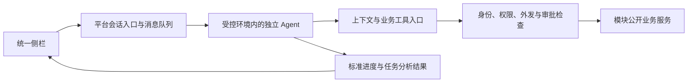

# OpenQMS Agent 任务生命周期与插件接入设计

日期：2026-09-26  
状态：访谈决策已确认；文档待复核；尚未实施。  
范围：侧栏任务、运行与检查点、授权与回滚、独立插件接入、迁移顺序。

关联：[总架构](2026-09-22-modular-qms-agent-architecture-design.md)、[模块权限规格](2026-09-26-qms-agent-module-permissions-design.md)、[权限内核计划](../plans/2026-09-26-agent-module-permission-kernel.md)。本文记录后续访谈，不代表权限内核已经接入生产，也不验证独立 worktree 的测试、合并或 PR 状态。

## 1. 架构边界

用户在 OpenQMS 统一侧栏向独立 Agent 提出需求。平台转交消息，Agent 自行解释需求、多轮查询、整合证据和安排工具调用；平台不审批完整执行计划，也不调度插件内部步骤。

平台记录任务目标、执行身份、插件及版本、消息、授权、业务操作和结果；插件管理模型、内部推理和工作流。标准任务结果不要求暴露模型私有思维链。

## 2. 已确认的授权语义

| 场景 | 规则 |
|---|---|
| 普通读取 | 在执行身份与插件预授权的交集内自动执行；允许按已有权限跨对象、跨工厂查询，不人为限定为当前工厂 |
| 读取约束 | 租户、敏感投影、来源限制和外发策略继续生效；自动读取不授予原文例外权限 |
| 当前 8D 写入 | 只能修改任务明确授权的报告；按业务动作分别授权，报告范围不隐含确认根因、推进或关闭权限 |
| 技术同步 | 允许相关审计、索引等必要技术同步；不得将供应商风险变更等业务联动包装成技术同步 |
| 跨业务联动 | 必须为一次具体操作申请授权，绑定对象、参数和影响；批准不扩大整项任务的持续权限 |
| 待审批 | 只阻塞依赖该批准的步骤，Agent 可以继续授权内的独立工作；不能通过其他工具绕过申请 |
| 页面切换 | 任务仍绑定原 8D；切换页面不切换授权对象 |
| 后台运行 | 离开页面或关闭侧栏后可继续；沿用原执行身份和授权，到期或撤权后拒绝后续调用 |

本轮细化总架构中的“任务授权”：任务需要可信的对象和权限边界，但不要求用户批准 Agent 的每一项计划步骤。普通读取采用预授权规则。模块权限规格中的敏感读取例外、强制人工审批与外发禁止仍有效。

对一次性跨业务批准，失败重试属于同一次操作，必须幂等；修改对象或参数需重新授权。工具的完整副作用由模块契约声明和约束，不以入口所属模块代替影响分析。

## 3. 任务、运行与插件版本

- **任务**：绑定发起者、执行身份、目标 8D、授权范围和标准业务产物。
- **运行**：一次具体执行，绑定一个插件及其版本；任务可以保留多轮运行。
- **消息**：发起者向任务提交的输入，保留独立身份、顺序和处理状态。
- **检查点**：关联输入位置、业务版本、操作清单及插件提供的恢复引用。
- **业务操作**：独立记录调用、审批、执行结果、业务版本和后续补偿关系。

这些是逻辑概念，不是已确定的数据库表或字段。

仅任务发起者可追加任务指令；其他有权员工可查看、审批或补充正式业务证据。审批意见作为结果返回，不成为改变任务方向的新指令。

每轮运行固定插件和版本。升级后新运行使用新版，已有运行继续原版本；旧版本被紧急禁用时停止调用，不因版本固定而保留旧权限。必须迁移时创建新运行，只保证标准业务产物可接续，不承诺内部状态跨版本兼容。

## 4. 消息接入与暂停恢复

执行中的新消息由平台排队，插件在下一次模型请求前、工具结果返回后等安全接入点按顺序纳入上下文，结合真实结果重新规划。追加消息不覆盖历史，不自动创建新运行或扩大权限。

消息接入点不同于恢复检查点：所有插件都要支持接收补充消息；只有声明恢复能力的插件才需要保存可恢复的内部状态。

用户可暂停任务并恢复。暂停后平台禁止新的工具调用；恢复前重新检查授权、当前业务状态和审批有效性。已提交的业务事务不能被描述为已撤销，应收集并展示实际结果。平台控制接口访问，不能仅凭一个暂停标志就声称远端进程已停止计算。

建议的消息可靠性契约：平台持久化消息 ID 与顺序，插件确认接收位置；重连重发时去重，界面区分已排队与已纳入上下文。精确投递和并发规则在接口规格中落定。

## 5. 回滚与新运行

用户可以选择检查点、查看撤销方案，并确认回滚范围。回滚同时处理任务进度和业务变更，但不使用整库快照覆盖当前业务状态。

1. 平台列出检查点之后的业务操作及影响，区分可撤销、存在冲突和需要独立授权的补偿。
2. 当前 8D 的变更通过所属模块提供的业务撤销动作处理，保留审计。被其他人修改、已确认或已有后续依赖的内容需复核。
3. 跨业务补偿单独申请一次性授权；原操作批准不自动覆盖撤销。
4. 允许用户确认后的部分回滚，逐项记录成功、冲突和失败；重试不得重复补偿。不能把部分完成展示为全部恢复。
5. 回滚后在同一任务下创建新运行，关联原检查点和补偿结果；旧运行不可恢复写入，其调用凭据失效，未执行审批不能直接沿用。
6. 新运行重新读取真实业务状态及证据版本，再处理修正后的输入；不能恢复旧记忆后假定现实业务已完全回退。

检查点的最低设计位置是用户新输入生效前及业务写操作前；输入采纳位置也需可追踪。平台保留业务关联，插件提供内部恢复引用。最终保存时序与失败恢复协议需在接口设计中明确。

插件按能力分级：所有插件遵守暂停、取消、旧运行失效和消息接入；支持恢复的插件可使用兼容检查点，不支持的从已有业务产物重新开始。界面明确说明可用的恢复方式。业务撤销机制属于平台和业务模块，不依赖插件是否支持内部恢复。

## 6. 任务资料与分析结果

用户补充的文字和上传文件首先属于任务资料，标明来源与验证状态；任务资料进入正式 8D 需显式调用业务工具。用户陈述不是已验证事实，附件、缓存和模型输入仍受模块权限规格的敏感数据规则约束。

只读阶段产出结构化任务分析结果：候选根因、支持与反对证据、缺失信息、条件性措施、来源及引用版本，并提供易读说明。结果保存在任务内，尚未成为正式 8D 条目。这里的“只读”指不修改质量业务对象；平台仍保存任务消息、分析结果与调用记录。

任务分析结果默认不进入统一搜索，仅对有任务访问权的人员及接续插件可见，并继续继承来源限制。发布到 8D 或知识库时执行独立业务操作，重新校验依据和授权。后续正式条目的验证状态规则沿用总架构，不能将“任务输出已保存”解释为“根因成立”。

## 7. 专用插件开发与部署

已确认：第一版面向为 OpenQMS 开发的专用 Agent，只接入自行部署、环境可验证且受控的服务。插件独立运行，模型与框架可选，但数据外发必须符合平台策略；内网部署本身不等于外发已受控。

交付标准建议包含：

| 部分 | 职责 |
|---|---|
| 插件清单 | 标识、版本、协议兼容范围、必需/可选能力、权限申请、恢复支持情况 |
| 模板与 SDK | 任务和消息接收、进度与结果事件、暂停与恢复适配、带运行身份的工具访问 |
| 部署包 | 独立容器、配置模板、健康检查和统一部署命令 |
| 示例插件 | 完整演示多轮只读 8D 分析，不依赖特定模型作为协议条件 |
| 契约检查 | 能力兼容、消息处理、停用与旧运行拒绝、标准结果结构验证 |

运维使用标准命令部署；后台负责登记、兼容检查、配置和授权启用，不在首版实现网页内拉取镜像和容器编排。安装成功不授予业务权限。平台禁用插件立即阻止接口调用，容器启停由运维管理。

侧栏统一呈现对话、进度、证据、结果和审批；插件返回标准数据与事件，不提供自定义前端。内部多模型或子 Agent 编排不扩大该运行权限，主插件承担统一接入责任。

参考 Discourse 的插件清单、开发骨架和管理注册思路，OpenQMS 的运行隔离仍按独立服务实现。参考 Claude Code 的消息排队交互，消息控制协议由 OpenQMS 自行定义：

- [Discourse 插件开发指南](https://meta.discourse.org/t/developing-discourse-plugins-part-1-create-a-basic-plugin/30515)
- [Claude Code 消息队列说明](https://code.claude.com/docs/en/interactive-mode#when-claude-code-sends-what-you-queued)

## 8. 分期与上线切换

1. **权限内核**：按既有独立计划建立测试内核；该切片的完成不等于运行接入已完成。
2. **只读任务链路，内部验收**：身份与任务绑定、能力发现、预授权查询、统一侧栏、消息队列、后台运行、暂停恢复及结构化任务结果。无业务写入，无需实现业务补偿，但先明确任务/运行/检查点的关联契约。
3. **写入与业务回滚**：结构化候选与措施、修订、正式命令、操作审批、跨业务一次性授权、撤销方案和部分回滚。
4. **正式替换入口**：完整“分析—建议—采纳”及必要审批/回滚验收通过后，直接替换原 D4/D5 推荐入口，不保留两个用户推荐入口。旧实现只作为受控部署回退手段。
5. **逐模块推广**：以样板验证过的协议和模板接入其他模块。

只读阶段不提前移除用户已有采纳能力。生产切换与回退需确认数据模型兼容、未完成任务处理及旧接口无权限旁路；不能假设回退界面等于可以回退结构化数据。

## 9. 后续接口规格与验收

已确定的产品边界不再逐字段访谈。下一步接口设计应落定：传输协议与 SDK 首发语言；任务及运行凭据、失效机制；消息确认和接入点；控制请求与在途调用的竞态；审批等待与超时；检查点存储和版本兼容；任务产物权限；部署凭据与网络限制；版本保留及清理；操作账本、撤销能力与部分失败恢复。

仍未确定的数据权威归属方案保留为总架构待定项。本文件不授权创建中央数据中心，不要求 Agent 直接读取业务数据库。

只读验收至少包括：页面切换不改目标；普通读取自动但不越权；敏感/外发例外继续生效；离线运行不切换执行身份；暂停/撤权后不发起新调用；消息顺序与重连去重；仅发起者可追加指令；结构化结果不进入全局搜索；插件版本固定且禁用仍生效；替换插件只承诺业务接续。

写入验收再覆盖：当前报告与外部联动区分；一次性授权不能扩权或重复执行；审批等待不阻塞无关步骤；检查点关联完整；部分回滚不覆盖人工修改；旧运行不能复活；新运行使用回滚后的真实状态；插件无恢复能力时明确重新开始。

## 10. 关键取舍

- 选平台统一会话入口，而非浏览器直连插件：统一身份、重连与任务控制，代价是需要稳定的消息协议。
- 选预授权下自主规划，而非审核完整计划：保留 Agent 的探索空间，以真实调用控制权限。
- 选业务补偿和新运行，而非恢复数据库快照：保留其他人的修改与审计，代价是承认部分回滚和冲突。
- 选固定插件版本，而非自动用最新版恢复：保证状态可解释，代价是运维需管理旧版本保留。
- 选专用模板和统一界面，而非首版适配所有框架和自定义 UI：先验证一个完整接入样板，后续按实际需要增加适配器。

若任务交互、部署规模或现成 Agent 接入需求发生变化，再通过新决策调整这些边界；不因实施方便而隐式改变授权或回滚语义。
